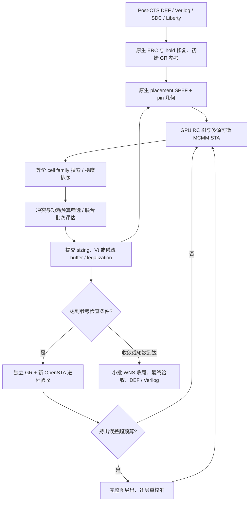

# ISPD2027 post-CTS 优化框架（lss 分支）

本分支在竞赛仓库中加入当前的 **sizing / Vt swap 优先、少量 buffering** 优化器。
输入为已经完成 CTS 的 AES/JPEG 网表和布局，不重新做 placement 或 CTS；修改后
执行 legalization。GPU STA 使用原生 placement RC，独立 OpenROAD/OpenSTA 使用
真实 global-routing RC 验收并按需校准模型。

- 原竞赛介绍、时间表与资源：[README.contest.md](README.contest.md)
- 竞赛规则：[Contest description](ISPD27-Contest-Description.pdf)
- 官方评测接口：[evaluator/README.md](evaluator/README.md)
- 迁入源码的逐文件用途：[SOURCE_FILES.csv](SOURCE_FILES.csv)

## 框架与数据流



1. **建立合法起点。** 使用原生 `repair_design` 修复 fanout、capacitance、slew，
   必要时修复 hold；保护 clock tree、clock cells 和 clock sinks。修复中的新单元
   与优化阶段插入的 buffer 分开统计。
2. **GPU RC 与时序。** 从 pin placement 对应的 OpenROAD 原生 placement SPEF
   构建 RC 树，缓存 net 几何并在换门后更新输入电容。按 level 传播 BC/TC/WC、
   early/late、rise/fall 时序；保留多个不同 startpoint 的 arrival 和 predecessor，
   setup 目标通过 autograd 反传到电气参数。独立参考读取 GR SPEF，GPU RC 不读取它。
3. **宽搜索、大批次 sizing。** gate 映射为 `(drive strength, Vt)` 库坐标；默认枚举
   完整合法等价 family，包括跨档和 drive/Vt 联合替换。梯度排序后按不同 gate、
   局部读写冲突、物理区域及各 corner leakage 预算选择批次。初始上限 128 gate，
   可增长到 512；联合 STA 不通过时裁剪贡献较差的操作，最多重试 6 次。
4. **功耗与 buffering。** 每 4 轮安排功耗步，使用 Liberty internal/switching/leakage
   模型；受 hold、WNS 和功耗预算保护。buffering 在 sizing 停滞或等待上限时探测，
   梯度选择最多 32 个 net，线程池并发调用 C++ bounded tree DP，保留有收益的
   完整方案。实际插入、legalization 和原生 GR/MCMM 验收后才接受拓扑变化。
5. **稀疏参考与校准。** 默认接受 8 批、累计修改 512 次、或变动 RC net 比例达到 5%
   时检查 GR；检查间隔可增长到 16 批。新进程读取当前 GR 的 DEF/SPEF，避免
   原地改 master 后常驻参考的状态偏差。先记录持出 MAE/P99，超过 1/5 ps 才完整
   导图并重校准；拓扑改变时重建模型。ERC 失败先尝试回退相关 gate，其他失败
   恢复已验收状态。批次 STA/RC 更新、GR 验收、全图重校准是三个不同成本项。
6. **收尾与输出。** 小批 WNS sizing 后做最终原生检查。仅当设计、pin 几何、实例表
   和指标与最近已验收参考一致时复用最终 GR，否则重算。输出后仍应运行官方
   evaluator 完成独立等价性与竞赛合法性认证。

## 目录与主要文件

| 路径 | 用途 |
| --- | --- |
| `quad/post_cts_workflow.py` | 主控制器、事务接受/回退、报告和最终输出 |
| `quad/run_post_cts.py` | 竞赛四位置参数接口 |
| `quad/prepare.py` | 从本仓库 Liberty/LEF 建立三 corner 库缓存 |
| `quad/workflow_policy.py` | 搜索、批次、冲突、预算及校准触发策略 |
| `quad/workflow_native.py`、`sta_server.py` | OpenROAD 事务、legalization、placement RC 与独立 GR 参考 |
| `quad/workflow_sta.py`、`tagged_arrival.{py,cu}` | 多 startpoint CUDA STA、反向和校准 |
| `quad/workflow_rc.py`、`tree_rc_cuda.py` | RC 树缓存、GPU 求解与导数 |
| `quad/workflow_buffering.py`、`workflow_buffer_dp.cpp` | 并发 buffer 候选动态规划 |
| `quad/cell_space.py`、`policy.py` | 合法等价 cell family 与候选枚举 |
| `quad/nlpm.py`、`power_cuda.py` | Liberty 功耗与敏感度 |
| `quad/audit_post_cts.py` | 使用已有参考单独测量 STA、梯度和重校准成本 |
| `tools/export_*.tcl` | 原生 timing graph 与 startpoint 导出 |
| `tools/fetch_contest_openroad.py` | 下载并校验已验证的竞赛 OpenROAD runtime |
| `tools/verify_cts_structure.py` | CTS 结构检查工具，亦供回归使用 |
| `tests/` | CPU/CUDA、梯度、RC、策略和事务回归 |
| `benchmarks/`、`platform/`、`evaluator/` | 原竞赛输入、ASAP7 平台与独立评测器 |
| `cache/`、`artifacts/`、`runs/` | 本地生成的库/编译/功耗缓存与实验输出；不入 Git |

基础 STA、RC、功耗实现之间仍有继承和共享依赖，因此 `quad/` 内的文件应一起保留；
详细清单见 CSV。本分支未复制历史实验、已淘汰脚本、额外 ISPD26 benchmark 或大型二进制。

## 环境准备

验证环境：Linux x86-64、Python 3.11.9、NumPy 1.26.4、SciPy 1.14.0、PyTorch 2.0.1
（CUDA 11.8 build）、系统 `nvcc` 12.0、`g++`。需要 NVIDIA GPU 与兼容驱动；完整
优化器没有 CPU-only 运行模式。首次运行会编译 CUDA tagged-arrival 和 C++ buffer DP。

本机若使用已经验证的 Conda 环境，可先执行 `conda activate insta`。新环境按以下步骤
准备；命令在仓库根目录执行：

```bash
cd ~/ISPD27-Contest
python3.11 -m venv .venv
source .venv/bin/activate
python -m pip install 'torch==2.0.1' --index-url https://download.pytorch.org/whl/cu118
python -m pip install -r requirements.txt
nvcc --version
g++ --version
python -c 'import torch; print(torch.__version__, torch.cuda.is_available()); assert torch.cuda.is_available()'
```

`nvcc` 需要单独安装 CUDA Toolkit；PyTorch wheel 不包含编译器。可设置
`NVCC=/absolute/path/to/nvcc`。原生工具需要竞赛版本的 MCMM `define_scene`、
`set_scene` 等 API，普通上游 OpenROAD 不保证兼容。

**已有竞赛工具时：** 按 [容器说明](docker/README.md) 准备环境，显式指定工具。
仓库的容器文档目前提供 v2；本优化器已有验证使用从 v1 提取的 runtime，不能把
两个版本的兼容性当作已验证结论。

```bash
export OPENROAD_EXE=/absolute/path/to/contest/openroad
# 独立 evaluator 需要；优化器本身不调用 formal。
export KEPLER_FORMAL_EXE=/absolute/path/to/kepler-formal
```

**需要重现已验证的 OpenROAD 二进制时：**

```bash
python tools/fetch_contest_openroad.py
export OPENROAD_EXE="$PWD/tools/contest-runtime/install/OpenROAD/bin/openroad"
"$OPENROAD_EXE" -version
```

下载器固定 v1 image layer 的 SHA256，下载约 3.45 GB，解压另需磁盘空间；无需
Docker daemon。来源保存在 `tools/contest-runtime/provenance.json`。宿主机还需满足
该二进制的动态库依赖，可用 `ldd "$OPENROAD_EXE"` 检查。脚本不会安装 Python/CUDA
环境，也不替代 Kepler Formal 的安装。未设置 `OPENROAD_EXE` 时，主 workflow
默认使用上面的本地 runtime 路径。

**首次准备库（或更新源码/库后）：**

```bash
python quad/prepare.py
```

这会生成 `cache/{BC,TC,WC}` 中的 catalog、timing、power 表及指纹。缓存含有文件
路径，移动仓库或从别处复制缓存后请删除 `cache/` 和 `artifacts/` 再重新生成；
不要复用旧工作区缓存。

## 运行优化

```bash
# 可选：限定一个 GPU；程序内部使用其可见编号 cuda:0。
export CUDA_VISIBLE_DEVICES=0

# 默认 20 轮 sizing/power，随后 3 轮 WNS 收尾。
python quad/post_cts_workflow.py aes runs/aes_default
python quad/post_cts_workflow.py jpeg runs/jpeg_default

# 较短的完整闭环：仍包含初始修复、独立 GR 与最终检查。
python quad/post_cts_workflow.py aes runs/aes_short --sizing-rounds 4 --tail-rounds 1

# 只做 sizing/Vt 优化；必要的初始 ERC/hold 修复仍可插入单元。
python quad/post_cts_workflow.py aes runs/aes_sizing --max-buffer-batches 0

python quad/post_cts_workflow.py --help
```

每次指定一个**尚不存在**的输出目录。`--max-seconds` 是批次边界上的软预算，
最终恢复、检查和输出仍会执行。部分关键参数：

| 参数 | 默认值 | 含义 |
| --- | ---: | --- |
| `--search-space` | `family` | 全部合法同族候选；`neighbors` 为四近邻 |
| `--topk` / `--max-topk` | 128 / 512 | 初始与最大提交 gate 数，非候选枚举数 |
| `--sizing-rounds` / `--tail-rounds` | 20 / 3 | 主循环和 WNS 收尾轮数 |
| `--power-interval` / `--power-growth` | 4 / 0.05 | 功耗步间隔、功耗增长守卫 |
| `--refresh-every` / `--max-refresh-every` | 8 / 16 | 独立参考检查的接受批次间隔 |
| `--reference-move-budget` / `--reference-rc-fraction` | 512 / 0.05 | 额外参考检查触发条件 |
| `--mae-ps` / `--p99-ps` | 1 / 5 | 持出 slack 误差阈值 |
| `--tag-k` / `--tag-max-k` | 8 / 64 | 每类保留的不同 startpoint 数 |
| `--buffer-nets` / `--workers` | 32 / 4 | buffer 候选 net 数与 DP 线程数 |
| `--buffers-per-net` / `--buffers-per-batch` | 2 / 4 | 每 net、每批优化 buffer 上限 |
| `--max-buffer-batches` / `--max-new-buffers` | 4 / 16 | 优化 buffering 总预算 |

实际接受数量还受冲突、收益、物理及功耗检查约束。每批局部时序更新不等于每批
调用 GR 或做一次完整校准。

## 提交接口和独立评测

运行优化并由官方 launcher 测量运行时间、验证结果：

```bash
python evaluator/run_submission.py aes runs/aes_submission -- \
  python "$PWD/quad/run_post_cts.py" --sizing-rounds 20 --tail-rounds 3
```

launcher 在命令末尾添加 `<input_dir> <platform_dir> <output_dir> <top_module>`。
当前适配器只接受**本 checkout 自带的** AES/JPEG 与 ASAP7 路径；其他输入不能直接
通过该入口。输出是 `tool/aes.def`、`tool/aes.v`，详细运行报告在 `tool/workflow/`。
JPEG 把设计名换成 `jpeg` 即可。

若已直接运行 workflow，可独立评测保存的结果：

```bash
bash evaluator/eval.sh aes runs/aes_independent_eval \
  --def runs/aes_short/solution/aes.def \
  --verilog runs/aes_short/solution/aes.v
```

评测需要正确设置 `OPENROAD_EXE`、`KEPLER_FORMAL_EXE`；评分和完整合法性条件见
[evaluator/README.md](evaluator/README.md)。本次迁移保留仓库原有 evaluator，
未将旧研究工作区中面向额外 benchmark 的 evaluator 修改覆盖进来。

## 输出与测试

直接运行的主要产物：

- `solution/<design>.def`、`solution/<design>.v`：最终提交结果。
- `report.json`：MCMM、接受/拒绝原因、修改数量、误差、校准记录、源码哈希和墙钟时间。
- `reference_*`、原生事务目录：placement/GR SPEF、图数据、指标和 OpenROAD 日志。

`WORKFLOW_COMPLETE` 表示 workflow 的最终原生约束检查通过；独立逻辑等价性与
竞赛认证以 evaluator 的输出为准。分阶段时间可能嵌套，不应相加；总时间读
`elapsed_seconds`。持出误差看 `heldout_accuracy_budget_pass`，不要用校准后的
拟合误差代替。

回归包含两项可选 FLUTE 参考实现检查，需要外部 DREAMPlace FLUTE 目录
（`flute.cpp`、`flute.hpp`、`LICENSE`、`lut.ICCAD2015/{POWV9,POST9}.dat`）。
主 workflow 使用原生 placement RC，不依赖该 FLUTE 实现。

```bash
# 完整回归：设置为本机实际路径，或把依赖放到 third_party/flute。
export QUAD_FLUTE_SOURCE=/absolute/path/to/DREAMPlace/thirdparty/flute
PYTHONPATH=quad:tests python -m unittest discover -s tests -v

# 无外部 FLUTE 时，可以先跑这组核心回归。
PYTHONPATH=quad:tests python -m unittest \
  test_workflow test_autograd_sta test_tree_rc_cuda test_power_propagation -v

# 官方 evaluator 自身的单元回归。
python -m unittest discover -s evaluator/tests -v

# 已有完整 reference 后，单独测量前向、梯度与重校准（不含 GR）。
python quad/audit_post_cts.py aes runs/aes_short/reference_000 runs/aes_sta_audit
```

本次迁移验证：151 项 CPU/CUDA 回归和 50 项官方 evaluator 单元测试通过；
JPEG 原生 MCMM 加载、clock 保护和快照导出通过；AES 从原始输入生成 placement
RC、独立 GR 参考及完整时序图后，GPU 三 corner 前向、13,814 个候选的梯度排序和
同拓扑重校准审计通过（`AUDIT_COMPLETE`）。重校准前后 endpoint 最大变化约
`0.000058 ps`，这是重复校准一致性检查，不是持出误差或完整优化收敛结果。

## 当前限制

已验证范围为自带 AES/JPEG、ASAP7、BC/TC/WC 单时钟约束。任意 SDC、generated
clocks、SRAM 不在已验证范围。startpoint 队列有界，电气 slew 仍采用 collapsed
模型；队列溢出和源点丢失会报告。early STA 用于 hold 检查，尚无 hold 目标的反向。
buffer DP 用固定 slew 生成候选，最终以联合 MCMM 验收。

1 ps MAE / 5 ps P99 是触发检查与校准的预算，**当前并未在宽搜索的所有 checkpoint
达标**。GPU 前向时间也不包含 GR、legalization、全图导出和初始化；不能将其当作
端到端优化时间。本次迁移保持搜索算法，并修复了从原始输入冷启动时的新参考进程访问空路由网格
的问题：该进程只输出 timing/ERC，物理指标从实际完成 GR 的父进程复制。
